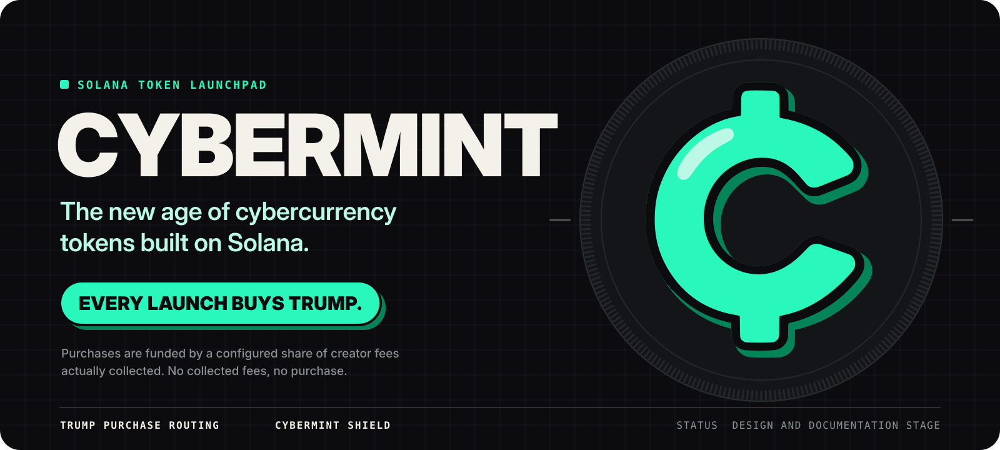
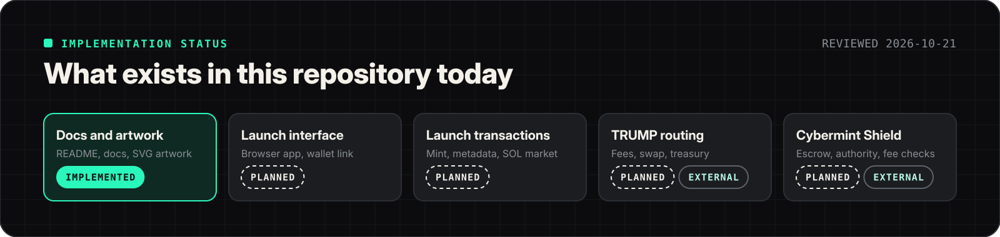
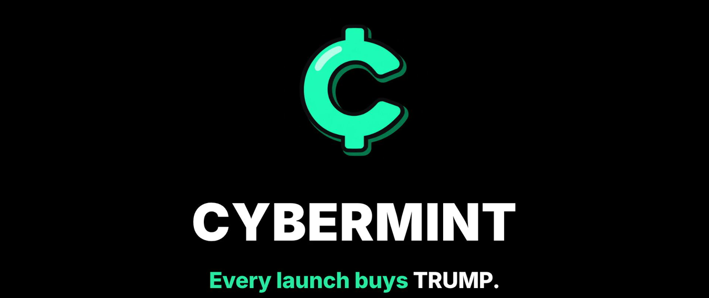
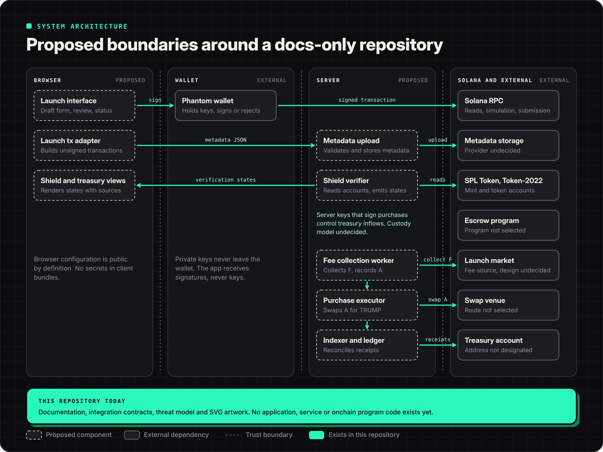
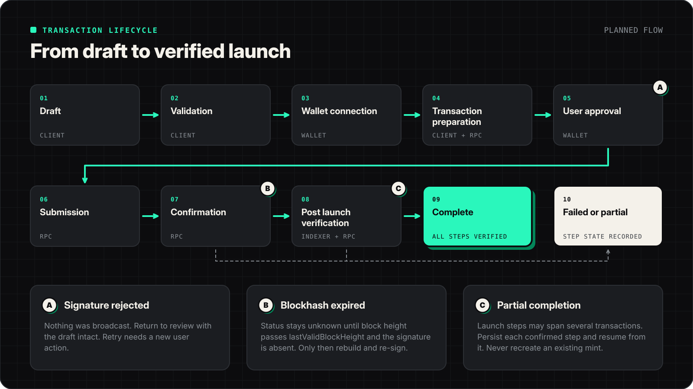
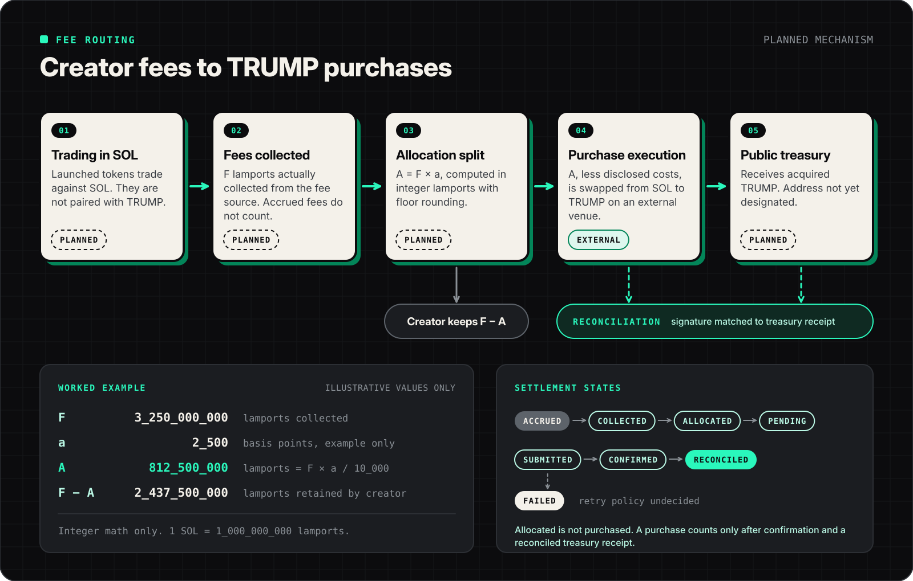

<p align="center">
  
</p>

<p align="center">
  <b>Cybermint is a Solana token launchpad in the design stage.</b><br>
  Tokens launch and trade in SOL. A disclosed share of the creator fees Cybermint actually collects is used to buy the designated TRUMP token into a public treasury. Cybermint Shield is a planned set of checks that lets anyone verify a launch's creator escrow, token authorities and fee routing from chain state.
</p>

<p align="center">
  <a href="#current-implementation-status">Status</a> &nbsp;&middot;&nbsp;
  <a href="#product-overview">Overview</a> &nbsp;&middot;&nbsp;
  <a href="#system-architecture">Architecture</a> &nbsp;&middot;&nbsp;
  <a href="#token-launch-lifecycle">Lifecycle</a> &nbsp;&middot;&nbsp;
  <a href="#fee-routing-and-treasury-accounting">Fee routing</a> &nbsp;&middot;&nbsp;
  <a href="#cybermint-shield">Shield</a> &nbsp;&middot;&nbsp;
  <a href="#trust-boundaries-and-limitations">Trust</a> &nbsp;&middot;&nbsp;
  <a href="#roadmap">Roadmap</a>
  <br>
  <a href="docs/architecture.md">architecture.md</a> &nbsp;&middot;&nbsp;
  <a href="docs/fee-routing.md">fee-routing.md</a> &nbsp;&middot;&nbsp;
  <a href="docs/shield.md">shield.md</a> &nbsp;&middot;&nbsp;
  <a href="docs/integration-contracts.md">integration-contracts.md</a> &nbsp;&middot;&nbsp;
  <a href="docs/threat-model.md">threat-model.md</a> &nbsp;&middot;&nbsp;
  <a href="docs/development.md">development.md</a>
</p>


## Current implementation status



Status labels used throughout this repository:

| Label | Meaning |
| :-- | :-- |
| **Implemented and verified** | Exists in this repository and has a check that ran and passed. |
| **Implemented, not verified** | Exists in this repository but nothing has confirmed it behaves as described. |
| **Planned** | Designed in these documents. No code exists. |
| **External integration required** | Depends on a program, venue or service outside this repository that has not been selected or integrated. |

| Capability | Status | What exists today |
| :-- | :-- | :-- |
| Product and technical documentation | Implemented and verified | This README and [`docs/`](docs). Links and anchors pass [`scripts/check-docs.mjs`](scripts/check-docs.mjs). |
| Repository artwork | Implemented and verified | SVGs in [`docs/assets/`](docs/assets), generated by [`tools/artwork/`](tools/artwork). The docs check confirms they are self contained. |
| Launch interface (browser app) | Planned | None. No framework has been chosen. |
| Phantom wallet connection | Planned, external integration required | None. |
| Mint creation and metadata | Planned, external integration required | None. Metadata storage provider is undecided. |
| SOL launch market and creator fee source | Planned, external integration required | None. Venue design is undecided, see [fee origin](#where-creator-fees-originate). |
| Fee collection and allocation accounting | Planned | Formula and states specified in [`docs/fee-routing.md`](docs/fee-routing.md). |
| TRUMP purchase execution | External integration required | None. Swap venue and route are not selected. |
| Public TRUMP treasury | Planned | No address has been designated. Custody model is undecided. |
| Indexing and reconciliation | Planned | Algorithm specified in [`docs/fee-routing.md`](docs/fee-routing.md#reconciliation). |
| Shield: authority checks | Planned | Check definitions in [`docs/shield.md`](docs/shield.md). |
| Shield: creator escrow | Planned, external integration required | No escrow program has been selected. |
| Shield: fee routing verification | Planned | Depends on how fee configuration is stored, which is undecided. |
| Application tests, audits, deployments | None | No application code exists to test, audit or deploy. |


## Product overview

### Who launches tokens

A **creator** connects a Solana wallet, fills in a token draft (name, symbol, image, supply and launch parameters) and approves the launch transactions in their own wallet. Cybermint never holds the creator's keys. Traders then buy and sell the new token against SOL.

### How SOL based launches work, conceptually

Each launched token is a new SPL mint. Its market is denominated in **SOL**. Launched tokens are **not paired with TRUMP**, and buying a launched token never requires holding TRUMP. TRUMP enters the system at only one point: the purchase step funded by collected creator fees.

The exact market mechanism (a Cybermint operated bonding curve, a pool on an existing automated market maker, or another design) is **undecided**. That choice determines who charges fees, where they accrue and who can collect them, so it is the most consequential open decision in the project.

### Where creator fees originate

Creator fees are a fee charged on trades of a launched token in its SOL market. Depending on the market design they would accrue to a fee account controlled by a Cybermint program, to a pool position, or to a configured fee recipient on a third party venue. Until a fee is **collected** (moved into an account Cybermint's fee process controls), it is only **accrued** and is not counted for TRUMP purchases.

### What fraction funds TRUMP purchases

A configured allocation fraction `a`, expressed in basis points, applies to fees actually collected:

```text
A = floor(F * a_bps / 10_000)
```

`F` is collected creator fees in lamports and `A` is the gross TRUMP allocation in lamports. **The production value of `a` has not been decided** and must be disclosed before any launch. The examples in this repository use 2_500 bps purely for illustration.

### Where acquired TRUMP goes

Purchased TRUMP is sent to a **public treasury** token account so anyone can audit its balance and history. The treasury address, who controls it, and whether TRUMP can ever leave it are **undecided** and must be published before launch. The TRUMP mint address must also be published by the maintainers and checked by software; this repository deliberately does not guess it.

### What Shield verifies

Shield reads chain state and reports, for each launch:

- whether the creator's token allocation sits in a time locked escrow, how much, and on what schedule it unlocks
- whether mint authority and freeze authority are revoked, which token program owns the mint, and which Token-2022 extensions are present
- whether the fee routing configuration matches what was disclosed, who can change it, and whether it can still change

### What Shield cannot establish

Shield cannot tell you whether a creator is honest, whether they bought through other wallets, whether holders will coordinate selling, what the token will be worth, or how an external program will behave after an upgrade. A launch with every check verified can still lose you money. See [Trust boundaries and limitations](#trust-boundaries-and-limitations).

### What Cybermint is not

Cybermint is an application that would run on Solana. It is not a blockchain, a layer 2, a privacy network or a security layer for Solana. This repository makes no claim of affiliation with, or endorsement by, the issuers of TRUMP, any person, or any government body.

<p align="center">
  <a href="docs/media/cybermint-launch-film.mp4"></a><br>
  <sub>Brand concept film (25 s, MP4). It depicts planned features and illustrative values, not a working product.</sub>
</p>


## System architecture



The only things that exist are on the bottom band: documentation and artwork. Every box above it is a proposed boundary, drawn so implementation can start from agreed seams rather than from a framework.

| Boundary | Responsibility | Holds keys? | Status |
| :-- | :-- | :-- | :-- |
| Browser interface | Draft form, review screen, launch progress, Shield and treasury views | No | Planned |
| Launch transaction adapter | Builds unsigned launch transactions, simulates them, tracks blockhash expiry | No | Planned |
| Phantom wallet | Shows transactions to the creator, signs or rejects | Creator keys | External |
| Solana RPC | Account reads, simulation, submission, signature status | No | External, provider undecided |
| Metadata upload service | Validates image and JSON, stores metadata, returns a URI | Storage credentials | Planned |
| Fee collection worker | Collects accrued fees, records `F`, computes `A` | Fee authority, if the design needs one | Planned |
| Purchase executor | Quotes and executes the SOL to TRUMP swap for `A` | Purchase signer | Planned, external venue |
| Treasury accounting and indexer | Ledger of allocations and purchases, reconciliation against treasury receipts | No | Planned |
| Escrow integration | Deposits creator allocation into a time locked escrow | No, the creator signs | External, program not selected |
| Shield verifier | Reads mint, metadata, escrow and fee accounts, emits verification states | No | Planned |

Server side components that sign transactions are the highest value targets in the system. Their custody model (hardware key, multisig, program derived authority with constrained instructions) is undecided and blocks the purchase executor. Detail, sequence diagrams and open decisions are in [`docs/architecture.md`](docs/architecture.md).


## Token launch lifecycle



| # | State | Entered when | Leaves when |
| :-: | :-- | :-- | :-- |
| 01 | **Draft** | Creator starts a launch. Draft gets a stable `launchId`. | Creator submits the form. |
| 02 | **Validation** | Client checks name, symbol, image size and type, supply bounds, decimals, allocation and lock parameters. | All fields valid, or errors shown and the draft returns to 01. |
| 03 | **Wallet connection** | App requests a connection and confirms the cluster by comparing the RPC genesis hash with the expected cluster. | Wallet connected on the expected cluster. |
| 04 | **Transaction preparation** | Adapter builds each step's transaction with a fresh blockhash, simulates it, and checks SOL balance against rent plus fees. | Simulation succeeds and the balance is sufficient. |
| 05 | **User approval** | Wallet shows the transaction. | Creator signs, or rejects (path A). |
| 06 | **Submission** | Signed transaction is sent to RPC. Signature and `lastValidBlockHeight` are persisted first. | RPC accepts it, or returns an error. |
| 07 | **Confirmation** | Client polls signature status. | Status reaches the required commitment, or the blockhash expires (path B). |
| 08 | **Post launch verification** | Shield reads the resulting accounts at `finalized` commitment. | Every enabled check resolves. |
| 09 | **Complete** | All steps confirmed and verified. | Terminal. |
| 10 | **Failed or partial** | A step failed after an earlier step confirmed (path C), or an unrecoverable error occurred. | Resumed from the recorded step, or abandoned with a record of what exists onchain. |

**Rejected signatures (A).** Nothing was broadcast, so nothing needs cleanup. The draft and any prepared state are kept. The app does not re-prompt automatically; the creator starts again with a new action.

**Expired transactions (B).** A Solana transaction is only valid while its recent blockhash is valid. The adapter stores `lastValidBlockHeight` with each signature. While the current block height is at or below that value, the outcome is unknown and the app keeps polling. Only after the block height passes it, and a signature status lookup with transaction history still finds nothing, is the transaction treated as expired. Then it is rebuilt with a new blockhash and must be signed again. Re-signing earlier risks two copies landing.

**Retry and idempotency.** Every step is keyed by `launchId` and step name. The mint address is fixed for a draft, so a retried creation either lands once or fails with the account already in use, which the adapter treats as "check whether the step already succeeded", not as an error to show.

**Partial completion (C).** A full launch likely spans several transactions (mint and metadata, initial supply, authority revocation, market setup, fee configuration, escrow deposit), because Solana transactions are size limited and some steps have different signers. The process is therefore not atomic. If the mint is created but the escrow deposit fails, the launch is **partial**: the token exists onchain, Shield reports escrow as Failed or Not enabled, and the UI must say so plainly. The step journal lets the creator resume from the failed step. The full step plan is in [`docs/architecture.md`](docs/architecture.md#launch-step-plan).


## Fee routing and treasury accounting



### Definitions

| Symbol | Unit | Definition |
| :-- | :-- | :-- |
| `F` | lamports | Creator fees **collected** in a collection event. Accrued but uncollected fees are excluded. |
| `a_bps` | basis points, integer 0 to 10_000 | Configured TRUMP allocation fraction. Production value undecided. |
| `A` | lamports | Gross allocation: `floor(F * a_bps / 10_000)`. Before any execution costs. |
| `F - A` | lamports | Remainder retained by the creator (or as the disclosed fee policy specifies). |
| `C` | lamports | Execution costs paid out of `A`, if the policy says costs come from the allocation. |
| `S` | lamports | Swap input: `A - C`. |
| `Q` | TRUMP base units | TRUMP actually received by the treasury, measured from the treasury token account balance change. |

All amounts are integers. SOL is in lamports (1 SOL = 1_000_000_000 lamports). TRUMP is in base units; its decimals are read from the mint account at runtime and never hard coded. No floating point arithmetic is used for money.

### Worked example (illustrative values)

```text
F       = 3_250_000_000 lamports          (3.25 SOL collected)
a_bps   = 2_500                            (example only, not a disclosed rate)
A       = 3_250_000_000 * 2_500 / 10_000   = 812_500_000 lamports
F - A   = 2_437_500_000 lamports retained
C       = 5_000 base fee + 20_000 priority fee (example) = 25_000 lamports
S       = 812_500_000 - 25_000            = 812_475_000 lamports swapped
```

`A` is what the policy sets aside, not what the treasury receives. The treasury receives `Q`, which depends on the venue price, venue fees and slippage at execution time.

### Settlement states

| State | Meaning | Counts toward "TRUMP bought"? |
| :-- | :-- | :-: |
| Accrued | Fee exists at the fee source but has not been collected | No |
| Collected | Fee moved into the fee process's control; `F` recorded with the collection signature | No |
| Allocated | `A` computed and reserved in the ledger | No |
| Purchase pending | Waiting for minimum size, quote or execution window | No |
| Purchase submitted | Swap transaction signed and sent; signature recorded | No |
| Purchase confirmed | Swap transaction reached finalized commitment | No |
| Purchase failed | Swap did not land or reverted; `A` returns to Allocated | No |
| Reconciled | Treasury balance change `Q` matched to the confirmed swap | **Yes** |

**Allocating funds is not the same as completing a purchase.** Public figures for TRUMP purchased must be computed from reconciled receipts only.

### Policies that are not yet decided

| Policy | Options under consideration | Status |
| :-- | :-- | :-- |
| Who pays execution costs | From `A` (disclosed as `C`), or paid separately by the operator | Undecided |
| Slippage limit | A maximum in bps, enforced through a minimum output amount on the swap | Undecided |
| Minimum purchase size | Accumulate allocations until `S` exceeds a threshold so fees do not dominate small buys | Undecided |
| Batching | One swap may fund several launches; attribution is pro rata by lamports in the ledger | Planned |
| Retries | Failed swaps return to Allocated and retry with a fresh quote; retry limit and alerting undecided | Planned |
| Rounding remainder | Floor rounding leaves at most one lamport per event with the creator | Planned |

Full accounting rules, ledger entries and the reconciliation algorithm are in [`docs/fee-routing.md`](docs/fee-routing.md).


## Cybermint Shield


Shield is **planned**. It is a set of reads and comparisons over public chain state, not a guarantee. Each check records the account it read, the slot, the commitment level and the time.

### Creator escrow

| Question | Current answer |
| :-- | :-- |
| What is deposited | The creator's token allocation of the launched mint, as disclosed in the launch draft. SOL and other assets are not escrowed. |
| How deposits are verified | Read the escrow's token account balance and compare base units exactly with the disclosed allocation. |
| How the schedule is represented | As read from the escrow program's account: start, cliff, end and release cadence, converted to timestamps for display. |
| Who can withdraw | Whoever the escrow account names as recipient, only for unlocked amounts. Shield displays this address. |
| Cancellation or admin withdrawal | Depends on the escrow program. Shield must read and display any cancel or admin authority. A lock that can be cancelled is reported as such. |
| Which external program | **Not selected.** Selection criteria are in [`docs/shield.md`](docs/shield.md#escrow-program-selection). |
| What remains outside the lock | Anything the creator holds or buys outside the escrowed allocation, including other wallets. Shield can show unescrowed balances only for wallets it knows about. |

No claim is made that any escrow program is immutable or audited. If the selected program is upgradeable, Shield must display its upgrade authority.

### Authority checks

| Check | Verified when |
| :-- | :-- |
| Mint authority | Mint account's mint authority is `None`. |
| Freeze authority | Mint account's freeze authority is `None`. |
| Token program | Mint is owned by SPL Token or Token-2022. Any other owner fails. |
| Token-2022 extensions | Every extension is enumerated with its authorities. Permanent delegate, pausable, non-transferable and default frozen state fail. Transfer hook, transfer fee config and mint close authority are shown as warnings. Unrecognized extensions are Unknown. |
| Metadata | Metadata update authority and mutability are displayed. |
| Provenance | Each result stores RPC endpoint, slot, commitment and timestamp. |

### Fee routing checks

| Check | Verified when |
| :-- | :-- |
| Allocation | Onchain or published configuration value equals the disclosed `a_bps`. |
| Destination | Purchase output goes to the published treasury token account for the published TRUMP mint. |
| Configuration authority | The account that can change the configuration is identified and displayed. |
| Changeability | Reported as "can change", "cannot change" or Unknown. Never assumed. |

### Verification states

| State | Meaning |
| :-- | :-- |
| **Verified** | The check ran against finalized state within the freshness window and the condition holds. |
| **Pending** | The check started, or the relevant transaction is not yet finalized. |
| **Not enabled** | The protection was not configured for this launch. This is disclosed, never hidden. |
| **Failed** | The check ran and the condition does not hold. |
| **Unknown** | The check could not be evaluated: RPC error, unrecognized program, stale data, unparseable account. |

> [!WARNING]
> **Unknown is never treated as passed.** A launch summary is only "all verified" when every enabled check is Verified. Any Unknown makes the summary Unknown, and any Failed makes it Failed.

Check-by-check account layouts and the aggregation rule are in [`docs/shield.md`](docs/shield.md).


## Trust boundaries and limitations

| Boundary | What you trust | What can go wrong |
| :-- | :-- | :-- |
| Wallet signatures | The wallet shows the transaction you are signing | A compromised browser or wallet can misrepresent a transaction. Simulation results and readable summaries help but do not remove this. |
| Server privileges | Services that hold signing keys behave as specified | A compromised purchase signer could redirect allocated SOL. Custody model is undecided. |
| Treasury control | Whoever controls the treasury does not move TRUMP out | Until the treasury's authority is published and constrained, the treasury is a promise, not a mechanism. |
| Upgrade authority | Programs used (escrow, venue, any Cybermint program) do what they did when reviewed | An upgradeable program can change. Shield must show upgrade authorities. |
| Escrow program | The selected program enforces its schedule | A bug or admin path in the program defeats the lock. |
| RPC | Responses are correct and current | A stale or malicious RPC can return wrong state. Verification records the slot; important checks should be confirmed against a second provider. |
| External swap | The venue executes at the quoted terms within the slippage limit | Price impact, MEV and venue outages change `Q`. |
| Indexer | The ledger is complete and current | Indexer lag delays reconciliation. Lagging data must show as Pending, not as zero. |
| Client display | What the UI shows matches confirmed chain state | Optimistic UI is not chain state. Displays must label unconfirmed data. |

**Launch controls do not prevent all scams.** Shield cannot stop a creator from buying early through undisclosed wallets and selling, cannot prevent concentrated ownership, cannot stop market losses, and cannot judge a project's claims. Creator escrow only covers the allocation placed in escrow. The threat model is in [`docs/threat-model.md`](docs/threat-model.md).


## Frontend architecture

**No frontend exists in this repository.** There is no routing, component tree, state store, service layer, Three.js scene, chart integration, error boundary or styling code to document, and no libraries are in use. The brand film in [`docs/media/`](docs/media) is a video, not an application.

When the frontend is built, these are the requirements this documentation sets for it:

| Area | Requirement |
| :-- | :-- |
| Routes | Launch draft, launch progress by `launchId`, token page with Shield panel, treasury page. |
| State | Server state (chain reads, ledger) separated from local draft state. Draft persisted locally so a refresh does not lose it. |
| Adapters | All chain access through the launch transaction adapter and a read client. Components never construct transactions. |
| Configuration | Only browser safe values from [Configuration and secrets](#configuration-and-secrets). |
| Decorative 3D | Any 3D scene is decorative only, never displays data, honours `prefers-reduced-motion`, and has a static fallback. |
| Charts | Charts of treasury or fees use reconciled data only and label the data's slot and time. |
| Errors and loading | Every chain read has loading, empty, error and stale states. Errors are scoped so one failed panel does not blank the page. |
| Accessibility | Keyboard reachable flows, visible focus, text labels for every state (never color alone), sufficient contrast for the mint on near black palette. |
| Responsive | Launch and verification flows usable on a phone width screen, since mobile wallets are common. |


## Data model and integration contracts

There are no TypeScript interfaces in this repository because there is no TypeScript code. The entities below are **proposed** and are specified in [`docs/integration-contracts.md`](docs/integration-contracts.md): `Token`, `LaunchRequest`, `FeeAllocation`, `TreasurySnapshot`, `PurchaseRecord`, `ShieldVerification`, `CreatorLock` and `TransactionRecord`.

Conventions every contract follows: amounts are integers (`bigint` in TypeScript, decimal strings in JSON), addresses are base58 strings, and every chain derived value carries the slot it was read at.

```ts
// PROPOSED. Documentation only; no implementation exists.
type VerificationState = "verified" | "pending" | "not_enabled" | "failed" | "unknown";

interface ShieldCheckResult {
  check: "mint_authority" | "freeze_authority" | "token_program" | "token_extensions"
       | "escrow_balance" | "escrow_schedule" | "escrow_authority"
       | "fee_allocation" | "fee_destination" | "fee_config_authority";
  state: VerificationState;
  observed: string | null;   // e.g. authority address, or null when absent
  expected: string | null;
  account: string;           // address that was read
  slot: bigint;
  commitment: "confirmed" | "finalized";
  checkedAt: string;         // ISO 8601
  rpcEndpointLabel: string;  // which provider answered, never a URL with credentials
}
```


## Configuration and secrets

There is no application, so **no environment variables are read by any code today**. [`.env.example`](.env.example) lists the proposed **browser safe** variables with empty placeholders. Names are framework neutral; the chosen framework's public prefix will be added when one is selected.

| Variable (proposed) | Exposure | Notes |
| :-- | :-- | :-- |
| `CYBERMINT_PUBLIC_SOLANA_CLUSTER` | Browser | `devnet` or `mainnet-beta`. Checked against the RPC genesis hash. |
| `CYBERMINT_PUBLIC_RPC_URL` | Browser | Only if the URL carries no credentials. Keyed RPC URLs are server only and proxied. |
| `CYBERMINT_PUBLIC_TRUMP_MINT` | Browser | Must be published by maintainers. Not guessed here. |
| `CYBERMINT_PUBLIC_TREASURY_ADDRESS` | Browser | Not yet designated. |
| `CYBERMINT_PUBLIC_ESCROW_PROGRAM_ID` | Browser | Not yet selected. |
| `CYBERMINT_PUBLIC_TRUMP_ALLOCATION_BPS` | Browser | Display value only. The enforced value must come from chain or signed configuration. |
| `CYBERMINT_PUBLIC_METADATA_GATEWAY_URL` | Browser | Storage provider undecided. |

Server only values (documented in [`docs/development.md`](docs/development.md#server-only-configuration), never placed in `.env.example`): keyed RPC URLs, metadata storage credentials, purchase signer key material or its reference in a key management system, and indexer database credentials.

Anything included in a browser bundle is public. A value is browser safe only if publishing it on a billboard would be harmless.


## Local development

There is no application to install, build or run. There is no `package.json` and no lockfile. What you can do locally:

```bash
# Validate links, anchors, SVG safety rules and .env.example hygiene (Node.js 18+ only, no install step)
node scripts/check-docs.mjs
```

```bash
# Regenerate the SVG artwork after editing the generator (Python 3.10+)
python3 -m pip install -r tools/artwork/requirements.txt
python3 tools/artwork/build_assets.py docs/assets tools/artwork/logo-layers.json
```

The artwork generator converts all text to outlines using Inter and DejaVu Sans Mono, so the fonts must be installed locally. Font locations and other details are in [`docs/development.md`](docs/development.md).


## Testing and validation

### Checks that exist and their results

| Check | Command | Result on 2026-10-21 |
| :-- | :-- | :-- |
| Markdown links, images and anchors resolve | `node scripts/check-docs.mjs` | Passed |
| SVGs contain no scripts, `foreignObject`, event handlers or external references | same | Passed |
| No em dashes in Markdown or SVG text | same | Passed |
| `.env.example` contains no secret-like names or key-like values | same | Passed |
| Artwork renders without clipped text | Manual render in Chromium at 900 px and 1600 px width | Passed, by inspection |

There are no unit, integration or end to end tests because there is no application code. No audit has been performed.

### Proposed integration test checklist

These are acceptance tests for the future implementation, to be run against devnet and a local validator. None exist yet.

| Scenario | Expected behavior |
| :-- | :-- |
| User rejects signature | No broadcast, draft retained, state returns to review, no automatic re-prompt. |
| Wrong network | Genesis hash mismatch blocks preparation with a clear message. |
| Insufficient SOL | Preflight compares balance with rent and fees and blocks before the wallet prompt. |
| Expired blockhash | Status stays unknown until block height passes `lastValidBlockHeight`; then rebuild and re-sign. |
| Duplicate request | Same `launchId` and step never produce two mints or two deposits. |
| Partial launch completion | Mint exists, later step fails; launch shown as partial and resumable from the failed step. |
| Fee setup failure | Launch marked partial; fee routing check shows Failed or Not enabled, never Verified. |
| Incorrect TRUMP mint | Purchase executor refuses any output mint other than the configured one. |
| Swap slippage failure | Swap reverts on minimum output; allocation returns to Allocated; nothing is reported as bought. |
| Treasury receipt mismatch | Reconciliation flags the purchase; public totals exclude it until resolved. |
| Escrow not funded | Escrow check is Failed; launch summary cannot be "all verified". |
| Premature unlock attempt | Withdrawal before schedule is rejected by the escrow program; test asserts the program error. |
| Stale verification | Results older than the freshness window display as Unknown and are re-run. |
| RPC outage | Reads show Unknown, writes are blocked, nothing is shown as Verified or Failed from missing data. |


## Repository map

```text
.
├── README.md                     Entry point (this file)
├── CONTRIBUTING.md               Scope and rules for contributions
├── SECURITY.md                   Reporting status and scope
├── .env.example                  Proposed browser safe configuration, empty placeholders
├── .gitignore
├── docs/
│   ├── architecture.md           Components, launch step plan, sequences, open decisions
│   ├── fee-routing.md            Accounting, ledger, costs, reconciliation
│   ├── shield.md                 Check definitions, account reads, aggregation
│   ├── integration-contracts.md  Proposed TypeScript entities
│   ├── threat-model.md           Assets, actors, threats, residual risk
│   ├── development.md            Tooling, artwork pipeline, configuration
│   ├── assets/                   SVG and PNG artwork used by the docs
│   └── media/                    Brand concept film
├── scripts/
│   └── check-docs.mjs            Documentation checks (Node.js, no dependencies)
└── tools/
    └── artwork/                  Python generator for the SVG artwork
```

Ownership boundaries: `docs/` holds product and technical design and is the source of truth until code exists. `docs/assets/` is generated output; edit `tools/artwork/` and regenerate rather than hand editing outlined SVGs. `scripts/` holds repository checks only. Application code, when it arrives, should live in its own top level directories so documentation and code review stay separate.


## Roadmap

Milestones are defined by capability and exit criteria, not by dates. Nothing below is complete except M0.

| Milestone | Capability | Exit criteria | Status |
| :-- | :-- | :-- | :-- |
| M0 | Design and documentation | Docs and artwork published; docs check passes | Done |
| M1 | Decisions | Market venue, escrow program, swap route, treasury custody, `a_bps`, TRUMP mint and treasury address published | Not started |
| M2 | Devnet launch flow | Draft to complete on devnet with step journal, partial completion and expiry handling covered by tests | Not started |
| M3 | Shield read path | Authority and escrow checks against devnet accounts, all five states exercised in tests | Not started |
| M4 | Fee collection and accounting | Collection events recorded, `A` computed in integers, ledger reconciles to chain | Not started |
| M5 | Purchase execution | Swaps with minimum output, failure returns to Allocated, reconciliation against treasury receipts | Not started |
| M6 | External review | Independent review of any program, the signer custody model and the threat model before mainnet | Not started |


## Contributing and security reporting

Contributions to the documentation and artwork are the only kind this repository can take today. Read [`CONTRIBUTING.md`](CONTRIBUTING.md) first; the most important rule is that every capability claim carries one of the four status labels above.

**No private vulnerability reporting channel is configured yet.** Maintainers must enable one (for example GitHub private vulnerability reporting) before inviting sensitive reports. Until then, do not post exploit details publicly. See [`SECURITY.md`](SECURITY.md).

**License.** No license has been chosen. Without one, default copyright applies and no permission to use, copy or modify this work is granted. Choosing a license is a maintainer decision.

<br>

<p align="center">
  <br>
  <sub>Cybermint. Documentation and design stage. Nothing here is financial advice or a security guarantee.</sub>
</p>
