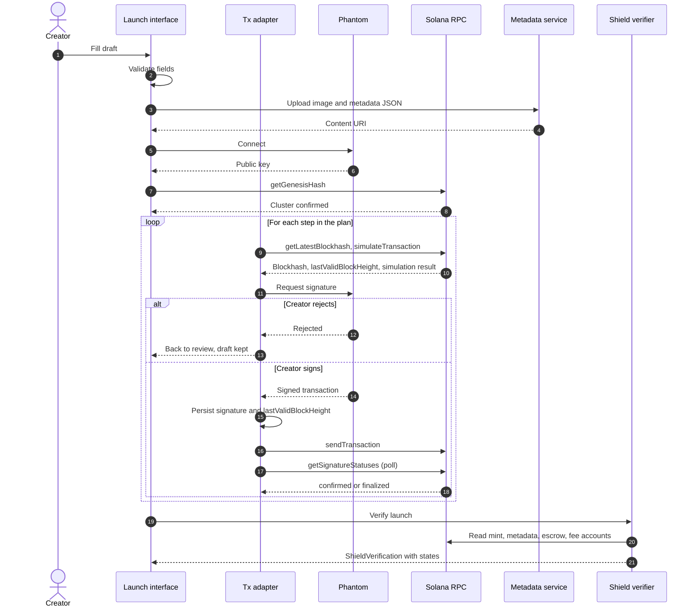
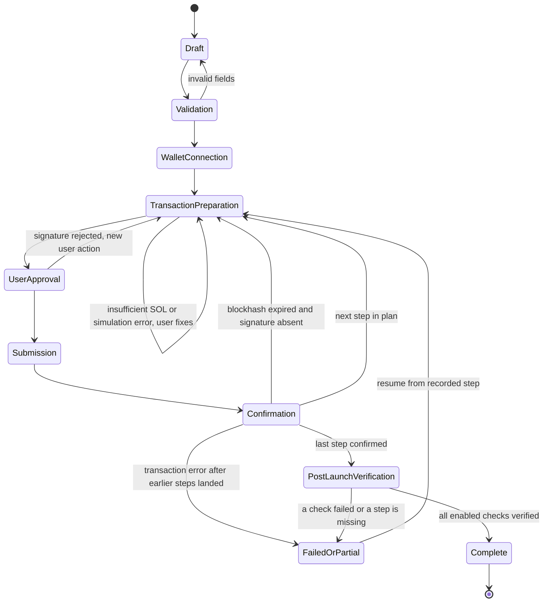
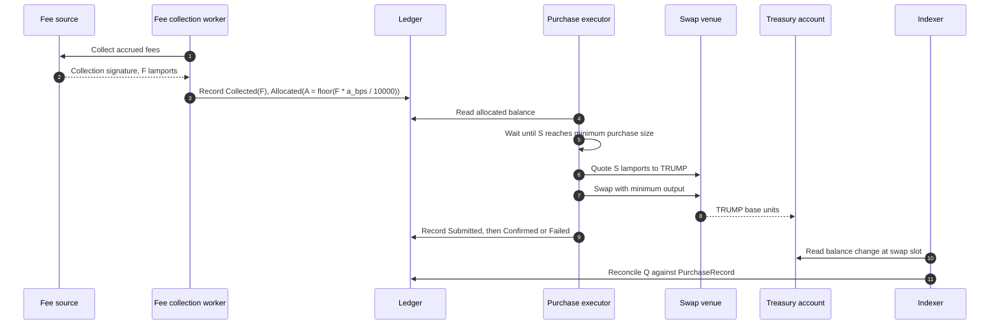

# Architecture

> [!IMPORTANT]
> Every component in this document is **proposed**. The repository contains documentation and artwork only. Status labels follow the definitions in the [README](../README.md#current-implementation-status).

## Contents

- [Design goals](#design-goals)
- [Components](#components)
- [Launch step plan](#launch-step-plan)
- [Launch sequence](#launch-sequence)
- [Launch state machine](#launch-state-machine)
- [Step journal](#step-journal)
- [Fee and purchase pipeline](#fee-and-purchase-pipeline)
- [Reads, commitment and freshness](#reads-commitment-and-freshness)
- [Open architecture decisions](#open-architecture-decisions)

## Design goals

1. **Creators sign their own launches.** No server holds creator keys. The server never signs a transaction that moves creator assets.
2. **Chain state is the source of truth.** Databases cache and index; they never override what the chain says. Every displayed chain value carries the slot it was read at.
3. **Non atomic work is explicit.** Launches and purchases span several transactions. Each step is recorded and resumable, and partial outcomes are shown as partial.
4. **Fail closed on verification.** A check that cannot be evaluated is Unknown, and Unknown never counts as passed.
5. **Smallest possible signing surface.** Server side signers exist only where the design cannot avoid them (fee collection, purchase execution), with narrowly scoped authority.

## Components

| Component | Lane | Inputs | Outputs | Signs? | Status |
| :-- | :-- | :-- | :-- | :-- | :-- |
| Launch interface | Browser | Creator input | `LaunchRequest` draft | No | Planned |
| Launch transaction adapter | Browser | `LaunchRequest`, RPC reads | Unsigned transactions, step journal updates | No | Planned |
| Read client | Browser | RPC, indexer API | Typed account views with slot | No | Planned |
| Phantom wallet | Wallet | Unsigned transactions | Signatures or rejection | Creator key | External |
| Metadata upload service | Server | Image, metadata JSON | Content URI | Storage credential | Planned |
| Shield verifier | Server or browser | Mint, metadata, escrow and fee accounts | `ShieldVerification` | No | Planned |
| Fee collection worker | Server | Fee source accounts | Collection transactions, `FeeAllocation` rows | Fee collection authority, if required | Planned |
| Purchase executor | Server | Allocated balance, swap quotes | Swap transactions, `PurchaseRecord` rows | Purchase signer | Planned |
| Indexer and treasury ledger | Server | Confirmed transactions, treasury account | `TreasurySnapshot`, reconciliation results | No | Planned |
| Solana RPC | External | Requests | Account data, simulation, signature status | No | External, provider undecided |
| SPL Token and Token-2022 | External | Instructions | Mint and token accounts | n/a | External |
| Token metadata program | External | Instructions | Metadata account | n/a | External, not yet confirmed as the choice |
| Escrow program | External | Deposit instruction | Escrow accounts | n/a | External, not selected |
| Launch market and fee source | External or Cybermint program | Trades | Accrued fees | n/a | Undecided |
| Swap venue | External | Swap instruction | TRUMP output | n/a | External, not selected |
| Treasury account | Chain | TRUMP transfers | Public balance | Custody undecided | Planned |

The Shield verifier can run in the browser (the user trusts their own RPC reads) or on a server (results are cached and served). Running both and comparing is the strongest option; which runs first is open.

## Launch step plan

A launch is a sequence of steps. Some may share a transaction; the grouping is decided by transaction size (Solana transactions are limited to 1232 bytes) and by signers. The plan below is the **proposed** ordering.

| Step | What happens | Signers | Can be retried safely because |
| :-- | :-- | :-- | :-- |
| `create_mint` | Create and initialize the mint account (SPL Token or Token-2022), with the creator's wallet as temporary mint authority | Creator, new mint keypair | The mint address is fixed for the draft; a second attempt fails with "account in use" |
| `create_metadata` | Create the metadata account pointing at the uploaded URI | Creator | Metadata address is derived from the mint; existence is checked before retry |
| `mint_supply` | Mint total supply to the launch market vault and the creator allocation account | Creator (as mint authority) | Supply is read back before retry; mint authority is still held so nothing is lost by waiting |
| `revoke_authorities` | Set mint authority and freeze authority to `None` | Creator | Idempotent in effect: if already `None`, skip |
| `open_market` | Initialize the SOL market for the token | Creator, possibly a program | Depends on the venue; market address should be derived from the mint |
| `configure_fees` | Set fee recipient and allocation configuration | Depends on venue | Configuration is read back and compared before retry |
| `escrow_deposit` | Deposit the creator allocation into the escrow program | Creator | Escrow account is derived or recorded; balance is read before retry |
| `verify` | Shield reads every account at `finalized` | None | Read only |

The order matters. Authorities are revoked only after supply is minted. Escrow deposit comes after supply exists. If `revoke_authorities` has not completed, the launch must not be presented as live.

The new mint keypair is generated in the browser and only needs to exist until `create_mint` lands. If it is lost before that (for example the tab closes), the adapter checks whether the mint address exists onchain. If it does not, a new keypair is generated and the old one is discarded. If it does, the launch continues from `create_metadata`.

## Launch sequence

## Launch state machine

## Step journal

The adapter writes a journal entry before every irreversible action. A proposed shape, documented as a contract in [integration-contracts.md](integration-contracts.md#transactionrecord):

| Field | Purpose |
| :-- | :-- |
| `launchId` | Stable draft identifier |
| `step` | One of the step names above |
| `attempt` | Increments on each rebuild |
| `signature` | Recorded before `sendTransaction` |
| `lastValidBlockHeight` | Decides when an unconfirmed transaction can be declared expired |
| `status` | `prepared`, `signed`, `submitted`, `confirmed`, `finalized`, `failed`, `expired` |
| `error` | Program error or RPC error text, if any |

Rules:

- **Persist before send.** If the app crashes after sending, the signature is still known and can be polled.
- **Expired means proven expired.** A transaction moves to `expired` only after the current block height exceeds `lastValidBlockHeight` and `getSignatureStatuses` with `searchTransactionHistory: true` returns nothing.
- **Never rebuild a step with a live attempt.** At most one attempt per step can be in `signed` or `submitted`.
- **Read back before retry.** Before retrying a step, read the account that step would create or change. If the desired state already exists, mark the step confirmed and move on.

Where the journal lives (browser storage, server database, or both) is undecided. Browser only storage loses the journal when the user changes device, so a server copy keyed by creator public key is likely needed.

## Fee and purchase pipeline

Accounting detail is in [fee-routing.md](fee-routing.md).

## Reads, commitment and freshness

| Use | Commitment | Reason |
| :-- | :-- | :-- |
| Progress display during launch | `confirmed` | Fast feedback, labelled as not final |
| Moving a launch step to done | `confirmed`, then `finalized` before verification | Avoid presenting rolled back state |
| Shield results shown as Verified | `finalized` | Verification must not depend on a fork |
| Reconciliation | `finalized` | Public totals must not reverse |

Every read stores the slot. A Shield result older than the freshness window (value undecided) is displayed as Unknown until re-run.

## Open architecture decisions

| Decision | Why it matters | Blocks |
| :-- | :-- | :-- |
| Launch market design and venue | Determines fee source, collection authority and whether a Cybermint program is needed | M1, M2, M4 |
| Whether Cybermint deploys its own program | Introduces upgrade authority and review requirements | M2, M6 |
| Escrow program | Determines lock semantics, cancellation and admin powers | M3 |
| Swap route | Determines execution quality and the trust placed in a venue | M5 |
| Treasury custody | Determines whether "public treasury" is enforceable or only observable | M5 |
| Purchase signer custody | Highest value server key | M5, M6 |
| Journal storage | Cross device resume and audit trail | M2 |
| Shield execution location | Trust and caching model for verification | M3 |
