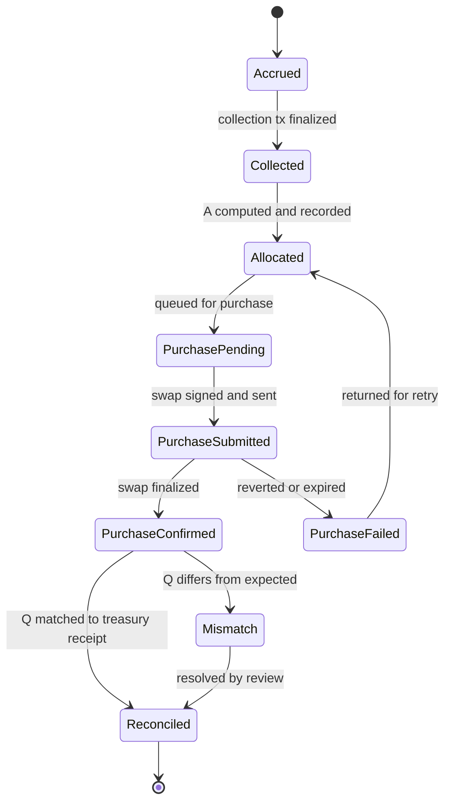

# Fee routing and treasury accounting


> [!IMPORTANT]
> This mechanism is **planned**. No fee collection, allocation, purchase or treasury code exists. Purchase execution is **external integration required**: no swap venue or route has been selected. The allocation fraction, TRUMP mint address and treasury address have not been published.

## Contents

- [Principle](#principle)
- [Amounts and units](#amounts-and-units)
- [Allocation formula](#allocation-formula)
- [Settlement states](#settlement-states)
- [Execution costs](#execution-costs)
- [Slippage and minimum output](#slippage-and-minimum-output)
- [Minimum purchase size and batching](#minimum-purchase-size-and-batching)
- [Retries](#retries)
- [Ledger entries](#ledger-entries)
- [Reconciliation](#reconciliation)
- [Public reporting rules](#public-reporting-rules)
- [Fee source options](#fee-source-options)
- [Open decisions](#open-decisions)

## Principle

"Every launch buys TRUMP" is true only in this sense: every launch that generates creator fees, once those fees are **collected**, contributes a configured share of them to TRUMP purchases. A launch with no trading generates no fees and funds no purchase. A purchase is only counted after it is **confirmed and reconciled** against the treasury.

## Amounts and units

| Quantity | Unit | Type in code | Source |
| :-- | :-- | :-- | :-- |
| SOL amounts | lamports, `1 SOL = 1_000_000_000` | `bigint` | Transaction balance changes |
| TRUMP amounts | base units, `10^d` per whole token | `bigint` | Treasury token account balance changes |
| TRUMP decimals `d` | integer | `number` | Read from the TRUMP mint account, never hard coded |
| Fractions | basis points, `10_000 = 100%` | `bigint` | Published configuration |

Floating point is never used for amounts. Display formatting converts integers to decimal strings at the edge only, with integer division and remainder:

```ts
// PROPOSED reference. Documentation only.
function formatUnits(amount: bigint, decimals: number): string {
  const base = 10n ** BigInt(decimals);
  const whole = amount / base;
  const frac = (amount % base).toString().padStart(decimals, "0").replace(/0+$/, "");
  return frac ? `${whole}.${frac}` : `${whole}`;
}
```

## Allocation formula

```text
F      creator fees collected in one collection event, lamports
a_bps  configured allocation, integer basis points, 0 <= a_bps <= 10_000
A      = floor(F * a_bps / 10_000)       gross TRUMP allocation, lamports
R      = F - A                           remainder, lamports
```

```ts
// PROPOSED reference. Documentation only.
const BPS = 10_000n;

export function allocate(collected: bigint, allocationBps: bigint) {
  if (collected < 0n) throw new RangeError("collected must be non-negative");
  if (allocationBps < 0n || allocationBps > BPS) throw new RangeError("allocationBps out of range");
  const allocated = (collected * allocationBps) / BPS; // bigint division floors for non-negative values
  return { allocated, remainder: collected - allocated };
}
```

Floor rounding means the allocation is never larger than the disclosed fraction. The rounding loss per event is under one lamport and stays with the remainder.

`a_bps` is applied **per collection event** using the configuration in force at the slot of collection. If configuration can change, the ledger stores the `a_bps` used for each event so historical allocations stay reproducible.

### Worked example

Illustrative values only. They are not a disclosed rate, a price or a forecast.

```text
Collection event
  F      = 3_250_000_000 lamports
  a_bps  = 2_500
  A      = 3_250_000_000 * 2_500 / 10_000 = 812_500_000 lamports
  R      = 2_437_500_000 lamports

Purchase, if costs are paid from A
  base fee      =      5_000 lamports  (1 signature)
  priority fee  =     20_000 lamports  (example)
  C             =     25_000 lamports
  S = A - C     = 812_475_000 lamports swap input

Quote and minimum output (TRUMP base units, decimals read from the mint)
  quoted out    = Q_quote
  slippage_bps  = 100 (example)
  min out       = floor(Q_quote * (10_000 - 100) / 10_000)

Receipt
  Q = treasury balance after - treasury balance before, at the swap slot
```

## Settlement states



| State | Recorded data | Public meaning |
| :-- | :-- | :-- |
| Accrued | Estimated amount at a slot | Fees exist but Cybermint does not control them yet |
| Collected | `F`, collection signature, slot | Fees received |
| Allocated | `A`, `a_bps` used, source collection | Set aside for TRUMP, not spent |
| Purchase pending | Batch id | Waiting to buy |
| Purchase submitted | Swap signature, `lastValidBlockHeight`, `S`, min out | In flight |
| Purchase confirmed | Slot, venue reported output | Swap landed, not yet matched |
| Purchase failed | Error | Nothing bought; funds return to Allocated |
| Mismatch | Expected and observed `Q` | Excluded from totals until resolved |
| Reconciled | `Q`, treasury balance before and after | Counts as TRUMP bought |

## Execution costs

| Cost | Typical source | Policy |
| :-- | :-- | :-- |
| Base transaction fee | 5_000 lamports per signature | Undecided whether paid from `A` |
| Priority fee | Compute unit price times compute units | Undecided; cap needed |
| Venue fee | Charged inside the swap, reduces `Q` | Disclosed per venue once selected |
| Price impact | Reduces `Q` | Bounded by slippage limit |
| Token account rent | Creating the treasury's TRUMP token account, once | Read with `getMinimumBalanceForRentExemption`; paid by the operator at setup (proposed) |

Whatever the policy, the ledger records `C` per purchase so `A = S + C` holds exactly for every purchase funded from the allocation.

## Slippage and minimum output

Each swap carries a minimum output amount computed from the quote and a maximum slippage in basis points. If the venue cannot deliver at least that amount the swap must revert, and the allocation returns to Allocated. The slippage limit is **undecided**. A tight limit causes more failed attempts; a loose one accepts worse prices. Whatever is chosen is disclosed.

## Minimum purchase size and batching

Small allocations can be dominated by fixed costs. A minimum swap input `M` (undecided) lets allocations accumulate:

- allocations queue in Purchase pending until their sum reaches `M`
- one swap may fund many launches
- attribution is **pro rata by lamports**: launch `i` contributed `S_i` of `S`, so it is credited `floor(Q * S_i / S)` base units, with the rounding remainder assigned to the largest contributor so totals match `Q` exactly

Batching means "every launch buys TRUMP" may happen with delay. The interface should show allocated but unpurchased amounts per launch.

## Retries

| Failure | Response |
| :-- | :-- |
| Swap reverted on minimum output | Return to Allocated, re-quote after a backoff |
| Blockhash expired, signature absent | Return to Allocated after proving expiry (same rule as launches) |
| Venue unavailable | Stay Pending, alert operators |
| Repeated failures | Retry limit and escalation undecided |

A purchase is never retried while an earlier attempt for the same allocation is Submitted and not proven expired.

## Ledger entries

A double entry style ledger keeps every lamport accounted for. Proposed accounts:

| Ledger account | Increases on | Decreases on |
| :-- | :-- | :-- |
| `fees_collected` | Collection event, by `F` | Allocation and remainder, by `F` |
| `trump_allocated` | Allocation, by `A` | Swap submission, by `S + C` |
| `creator_remainder` | Allocation, by `R` | Payout to creator |
| `execution_costs` | Swap submission, by `C` | Never (expense) |
| `swap_in_flight` | Swap submission, by `S` | Confirmation or failure |
| `trump_received` (base units) | Reconciliation, by `Q` | Never, unless treasury policy allows outflows |

Invariant checked on every write: `fees_collected` in equals `trump_allocated` plus `creator_remainder` in, for each collection event.

## Reconciliation

For each confirmed purchase:

1. Fetch the swap transaction at `finalized` commitment.
2. From its token balance metadata, take the treasury TRUMP token account's pre and post balance. Confirm the account's mint equals the published TRUMP mint and its owner equals the published treasury authority.
3. `Q = post - pre`. If other transfers to the treasury occurred in the same transaction, attribute only the swap output.
4. Compare `Q` with the venue reported output and with the minimum output. `Q >= min out` must hold.
5. If consistent, mark Reconciled. Otherwise mark Mismatch and exclude from public totals.
6. Periodically compare the sum of reconciled `Q` with the treasury account's current balance. A difference means unrecorded inflows or outflows and must be explained publicly.

## Public reporting rules

- "TRUMP bought" totals use **Reconciled** purchases only.
- "Allocated, not yet purchased" is reported separately and labelled.
- Every total shows the slot and time of the data it was computed from.
- Indexer lag shows as Pending, never as zero.
- Illustrative numbers are always labelled as illustrative.

## Fee source options

The fee source is the least decided part of the design. Options, each with consequences:

| Option | Fee asset | Collection | Notes |
| :-- | :-- | :-- | :-- |
| Cybermint operated bonding curve or market program | SOL | Program instruction | Requires a Cybermint program, upgrade authority and review |
| Third party pool with creator fee features | SOL or both sides | Venue specific claim | Depends on venue terms and authority model |
| Token-2022 transfer fee extension | The launched token | Harvest withheld amounts, then withdraw with the withdraw authority | Fees arrive in the launched token, so converting to SOL means selling it; that sale must be disclosed. Shield flags the extension and its authority. |

Until one is chosen, `F` is defined as SOL lamports collected. Any conversion from another asset into SOL before allocation is a separate, disclosed step.

## Open decisions

- Production value of `a_bps`, and whether it is fixed or configurable
- Who can change it, and whether changes apply only to future collections
- Who pays execution costs
- Slippage limit, minimum purchase size `M`, retry limit
- Swap venue and route
- TRUMP mint address (to be published by maintainers, verified by software)
- Treasury address, custody, and whether any outflow is ever permitted
