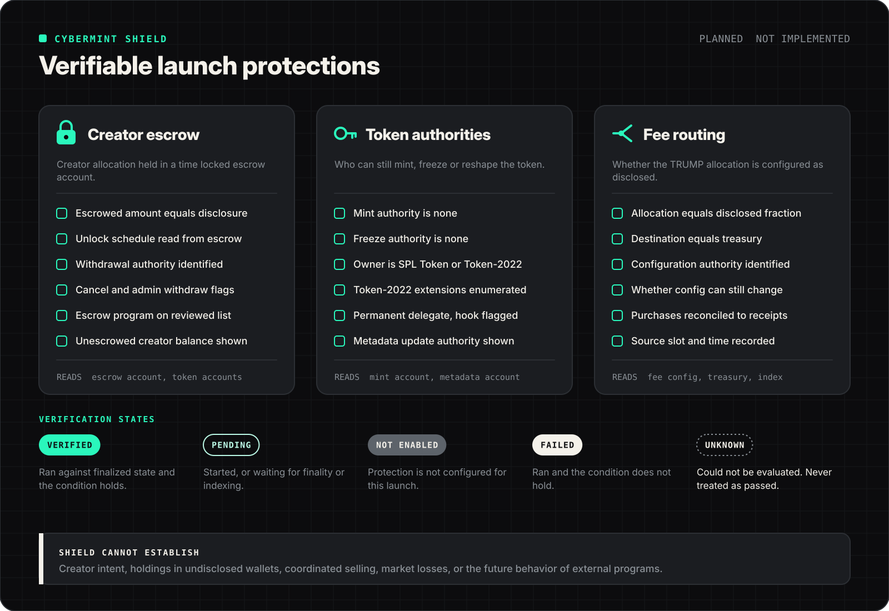

# Cybermint Shield



> [!IMPORTANT]
> Shield is **planned**. No verifier code exists. Creator escrow is **external integration required**: no escrow program has been selected. Shield reports what chain state shows at a slot. It is not an audit, a rating or a guarantee.

## Contents

- [What Shield is](#what-shield-is)
- [Verification states](#verification-states)
- [Aggregation rule](#aggregation-rule)
- [Authority checks](#authority-checks)
- [Token-2022 extensions](#token-2022-extensions)
- [Metadata checks](#metadata-checks)
- [Creator escrow checks](#creator-escrow-checks)
- [Escrow program selection](#escrow-program-selection)
- [Fee routing checks](#fee-routing-checks)
- [Provenance and freshness](#provenance-and-freshness)
- [What Shield cannot establish](#what-shield-cannot-establish)

## What Shield is

Shield is a set of deterministic reads and comparisons. Each check:

1. names the account it reads
2. reads it at a stated commitment and records the slot
3. compares observed values with expected values from the launch's disclosure
4. emits exactly one of five states, with observed and expected values attached

Anyone with RPC access should be able to reproduce every result from the recorded account addresses and slot.

## Verification states

| State | Emitted when | Displayed as |
| :-- | :-- | :-- |
| `verified` | Read succeeded at `finalized`, within the freshness window, and the condition holds | Pass, with slot and time |
| `pending` | The launch step the check depends on is not finalized, or the read is in progress | In progress |
| `not_enabled` | The protection was not configured for this launch (for example, no escrow chosen) | Not enabled, stated plainly |
| `failed` | Read succeeded and the condition does not hold | Fail, with observed and expected values |
| `unknown` | The check could not be evaluated: RPC error, timeout, unrecognized owner program, unknown extension, unparseable data, or a result older than the freshness window | Unknown, never styled as a pass |

## Aggregation rule

A launch summary combines the individual checks. **Unknown never counts as passed**, and Not enabled is never silently dropped.

```ts
// PROPOSED reference. Documentation only.
type VerificationState = "verified" | "pending" | "not_enabled" | "failed" | "unknown";

function summarize(states: VerificationState[]): VerificationState {
  if (states.length === 0) return "unknown";
  if (states.includes("failed")) return "failed";
  if (states.includes("unknown")) return "unknown";
  if (states.includes("pending")) return "pending";
  if (states.every((s) => s === "verified")) return "verified";
  return "not_enabled"; // at least one protection off, the rest verified
}
```

The interface lists every check individually. A summary is a convenience, never a replacement for the detail.

## Authority checks

Mint accounts are read directly. Layout facts used by the checks:

| Item | Value |
| :-- | :-- |
| SPL Token program | `TokenkegQfeZyiNwAJbNbGKPFXCWuBvf9Ss623VQ5DA` |
| Token-2022 program | `TokenzQdBNbLqP5VEhdkAS6EPFLC1PHnBqCXEpPxuEb` |
| Base mint layout | `mint_authority` (optional key), `supply` (u64), `decimals` (u8), `is_initialized` (bool), `freeze_authority` (optional key); 82 bytes |
| Token-2022 extensions | Type length value entries after the base account data and account type byte |

| Check | Condition for `verified` | `failed` when | `unknown` when |
| :-- | :-- | :-- | :-- |
| Token program | Mint account owner is one of the two programs above | Owner is any other program | Account missing or read error |
| Mint authority | `mint_authority` is `None` | Any key is set | Data unparseable |
| Freeze authority | `freeze_authority` is `None` | Any key is set | Data unparseable |
| Supply | `supply` equals the disclosed total supply in base units | Differs | Read error |
| Decimals | Equals disclosed decimals | Differs | Read error |

While a launch is in progress the creator legitimately holds mint authority, so authority checks report `pending` until `revoke_authorities` is finalized.

## Token-2022 extensions

Every extension on the mint is enumerated and shown with its authorities. The proposed policy:

| Extension | Effect | Proposed result |
| :-- | :-- | :-- |
| Permanent delegate | A key can transfer or burn from any holder's account | `failed` unless the delegate is `None` |
| Non-transferable | Tokens cannot be traded | `failed` for a tradable launch |
| Pausable | A key can halt transfers | `failed` unless the authority is `None` |
| Default account state (frozen) | New accounts start frozen | `failed` |
| Transfer hook | A program runs on every transfer and can block it | Shown as a warning with the hook program and its upgrade authority; `unknown` if the hook program cannot be identified |
| Transfer fee config | A fee is withheld on transfers | Shown with fee bps, maximum fee and both authorities |
| Mint close authority | A key can close the mint at zero supply | Shown with the authority |
| Interest bearing or scaled UI amount | Displayed amounts differ from raw amounts | Shown; displays use raw base units |
| Confidential transfers | Balances can be hidden | Shown; balance based checks may become `unknown` |
| Metadata pointer, token metadata | Metadata stored on or pointed to by the mint | Feeds the metadata checks |
| Any extension not recognized by the verifier | Unknown behavior | `unknown` |

## Metadata checks

| Check | Reported |
| :-- | :-- |
| Metadata account exists and points at the uploaded URI | `verified` or `failed` |
| Update authority | Displayed; whether it is `None` |
| Mutability | Displayed; a mutable name, symbol or image can change after launch |

If the Metaplex Token Metadata program (`metaqbxxUerdq28cj1RbAWkYQm3ybzjb6a8bt518x1s`) is used, the metadata address is derived from the mint. If Token-2022 metadata extensions are used instead, they are read from the mint. Which is used is undecided.

## Creator escrow checks

| Check | Condition for `verified` |
| :-- | :-- |
| Escrow program | Escrow account is owned by the selected, published escrow program ID |
| Deposit | Escrow token account's mint is the launch mint and its balance equals the disclosed creator allocation in base units |
| Schedule | Start, cliff, end and cadence read from the escrow account equal the disclosed schedule |
| Recipient | Recipient equals the disclosed creator address |
| Cancellation | Cancel or admin authorities are read and displayed. If any exist, the result states that the lock can be cancelled and by whom |
| Program upgradeability | Upgrade authority of the escrow program is read and displayed |
| Unescrowed balance | Creator's known wallet balance of the launch token outside escrow is displayed |

`not_enabled` if the launch was configured without escrow. `failed` if escrow was configured but the deposit is missing or short. Partial unlocks are expected over time; the check compares against the schedule at the read slot, not against the original deposit alone.

### What remains outside the lock

- tokens held in any wallet other than the escrow
- tokens the creator buys later, through any wallet
- SOL, fee income and anything not deposited
- the creator's ability to sell unlocked amounts as they vest

## Escrow program selection

No program is selected. A program should not be selected without answers to:

| Criterion | Question |
| :-- | :-- |
| Source | Is the source public and does it match the deployed program (verifiable build)? |
| Upgradeability | Who holds upgrade authority? Is it revoked or behind a multisig with a delay? |
| Review | Has it been independently reviewed? Evidence must be linkable; this repository claims none. |
| Cancellation | Can the sender, recipient or an admin cancel or withdraw early? |
| Token-2022 support | Does it handle Token-2022 mints and the extensions launches may use? |
| Account readability | Can schedule and authorities be parsed from accounts without trusting an API? |

## Fee routing checks

| Check | Condition for `verified` | `unknown` when |
| :-- | :-- | :-- |
| Allocation | Stored `a_bps` equals the disclosed value | Configuration is off chain and unsigned |
| Destination | Purchase output account equals the published treasury token account for the published TRUMP mint | Not published |
| Configuration authority | Identified and displayed | Cannot be determined |
| Changeability | Reported as `can_change` or `cannot_change` with evidence | Evidence is missing |
| Purchase history | Reconciled purchases exist for collected fees past the minimum size | Indexer behind |

How fee configuration is stored depends on the fee source design, which is undecided (see [fee-routing.md](fee-routing.md#fee-source-options)). If configuration lives only in a server database, Shield cannot verify it from chain state, and the honest result is `unknown`.

## Provenance and freshness

Each result records: account address, owner program, slot, commitment, time, RPC provider label, verifier version. The freshness window (undecided) is the maximum age before a result is shown as `unknown` and re-run. Results that matter most (authorities, escrow balance) should be confirmed against a second RPC provider before display as `verified`.

## What Shield cannot establish

- whether the creator or associates hold tokens in undisclosed wallets
- whether holders will coordinate selling
- whether the token will hold any value
- whether a project's claims, branding or social presence are genuine
- how an upgradeable program will behave after its next upgrade
- that an escrow program has no bugs

A fully verified launch can still lose buyers money.
